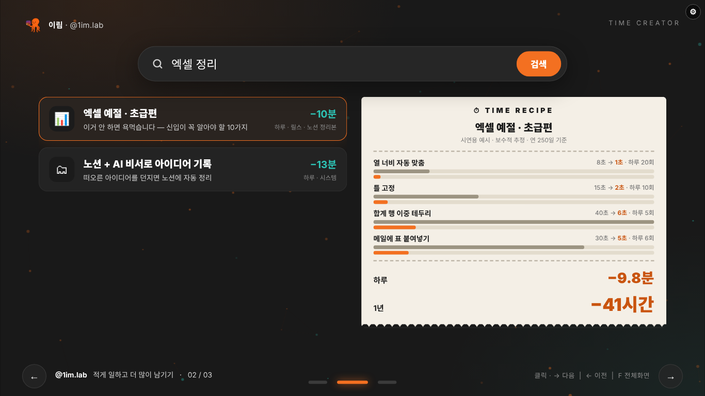
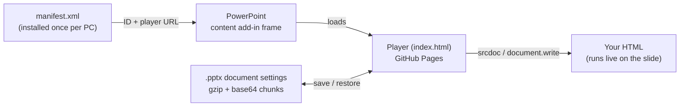

<p align="center">
  
</p>

<h1 align="center">1im HTML Player</h1>

<p align="center">
  <b>Put live, interactive HTML inside a PowerPoint slide.</b><br>
  Clicks, typing, sliders and animations keep working in Slide Show.<br>
  <sub>PowerPoint 슬라이드 안에서 인터랙티브 HTML을 그대로 발표하세요.</sub>
</p>

<p align="center">
  <a href="dist/1im-HTML-Player.zip"><b>⬇ Download</b></a> ·
  <a href="https://shopwaveglobal-cpu.github.io/ppt-html-embed/support.html">Docs</a> ·
  <a href="#한국어">한국어</a> ·
  <a href="LICENSE">MIT License</a>
</p>

<p align="center">
  
</p>

---

## Why

Microsoft retired the original **Web Viewer** add-in in December 2024, and the older **LiveWeb / WebBrowser ActiveX** tricks were blocked years ago. So "how do I put an interactive web page in my slides?" usually ends with *"you can't — record a video instead."*

You can. PowerPoint still officially supports **content add-ins** — a web view that lives on the slide. 1im HTML Player is a small, generic player built on that:

- **Drop an HTML file** onto the slide (or paste an https URL).
- The HTML is **saved inside the .pptx** (compressed into document settings). Nothing is uploaded anywhere — just share the file.
- **Different HTML on every slide.**
- **Presenter-friendly:** the first click in Slide Show only grabs keyboard focus (no accidental advance), then arrow keys go to your HTML.
- No account, no sign-in, no tracking.

## How it works



| Part | Where it lives | Role |
|---|---|---|
| `manifest.xml` | each PC / browser, once | tells PowerPoint the add-in exists and where the player is |
| `index.html` (player) | GitHub Pages | empty shell shared by every deck: drop zone, ⚙ button, focus helper |
| your HTML | **inside the .pptx** | the actual content, per slide frame |

## Install

| PowerPoint | How |
|---|---|
| **Web** (powerpoint.office.com) | Add-ins → More Add-ins → **Upload My Add-in** → `manifest.xml` |
| **Microsoft 365 / 2021+ on Windows** | run `install-windows.cmd` (as administrator → also sets up the shared-folder catalog) |
| **Microsoft 365 on Mac** | right-click `install-mac.command` → Open |
| Office 2019 and earlier | not supported (legacy IE/EdgeHTML engine) → use the web version |

Then: **Insert → My Add-ins → 1im HTML Player**, stretch the frame over the slide, drop your HTML. Full steps and troubleshooting: [`설명서.txt`](설명서.txt) / [support page](https://shopwaveglobal-cpu.github.io/ppt-html-embed/support.html).

## Things I learned building this

These cost real debugging time and are hard to find in the docs:

1. **`RequestedWidth` / `RequestedHeight` must be 32 – 1000.** With 1280×720 the add-in worked on PowerPoint for the web but **silently disappeared** from the list in desktop PowerPoint (no error at all). Fixed with 1000×563 + a version bump to bust the cache. Now enforced by [`scripts/check-manifest.py`](scripts/check-manifest.py) and CI.
2. **Office 2019 runs add-ins in a legacy engine** (IE11 / EdgeHTML). The player itself is written in ES5 with fallbacks (no `Promise` / `srcdoc` required, `pako` for decompression), but most modern, AI-generated HTML still won't run there. The player shows the detected engine so you can tell instantly.
3. **Keyboard focus belongs to PowerPoint** until you click inside the frame, so arrow keys skip slides (and end the show on the last slide). The player swallows the first click and shows a "⌨ keyboard connected" badge.
4. **Desktop has no "Upload My Add-in" button.** Windows needs a registry entry or a *trusted shared-folder catalog* (UNC path, English-only path is safest); Mac needs a file in the `wef` folder.

## Repository layout

```
index.html               player (served by GitHub Pages from gh-pages)
manifest.xml             add-in manifest (ContentApp, 1000×563)
install-*.cmd/.command   installers (copy the bundled manifest; no download)
설명서.txt               user manual (Korean)
dist/                    ready-to-share zip
examples/                sample interactive HTML
store/                   Microsoft Marketplace submission kit
scripts/check-manifest.py  offline manifest rules
.github/workflows/       CI: offline rules + office-addin-manifest validate
```

Develop: edit `index.html` → push `main` → `git push origin main:gh-pages`. Before releasing a manifest change:

```bash
python3 scripts/check-manifest.py manifest.xml store/manifest-store.xml
npx office-addin-manifest validate manifest.xml
```

---

## 한국어

**PPT에 웹페이지를 통째로 넣고, 발표 중에도 클릭·입력·애니메이션이 그대로 동작하게 하는 PowerPoint 추가 기능입니다.**

Web Viewer가 2024년 12월 종료된 뒤 "이제 PPT에 HTML은 못 넣는다"는 말이 많았지만, PowerPoint의 공식 기능인 **콘텐츠 추가 기능**을 이용하면 지금도 됩니다.

- HTML 파일을 슬라이드에 **끌어놓기만** 하면 끝
- 내용은 **PPT 파일 안에 저장** — 외부 업로드 없음, 파일만 공유
- 슬라이드마다 다른 HTML 가능
- 슬라이드쇼에서 첫 클릭은 키보드 연결만 (실수로 넘어가지 않음)

**설치**: [zip 다운로드](dist/1im-HTML-Player.zip) → 압축 해제 → `설명서.txt` 순서대로
- 웹 PowerPoint: 추가 기능 → 내 추가 기능 업로드 → `manifest.xml`
- Microsoft 365 / 2021 이상: Windows `install-windows.cmd`, Mac `install-mac.command`
- Office 2019 이하: 미지원 → 웹 PowerPoint 사용

**알려진 한계**: 발표 중 인터넷 연결 필요 · 발표 PC에도 한 번 설치 필요 · 수 MB 이상 HTML은 https 주소 방식 권장

---

<p align="center">
  Made by <a href="https://www.instagram.com/1im.lab/">이림 @1im.lab</a> — 적게 일하고 더 많이 남기는 방법 · TIME CREATOR<br>
  <sub>Code: MIT License. The 1im logo/icons (<code>assets/</code>) and the sample content in <code>examples/</code> are © 이림 and not covered by the MIT license (see <a href="NOTICE">NOTICE</a>).<br>Not affiliated with Microsoft.</sub>
</p>
